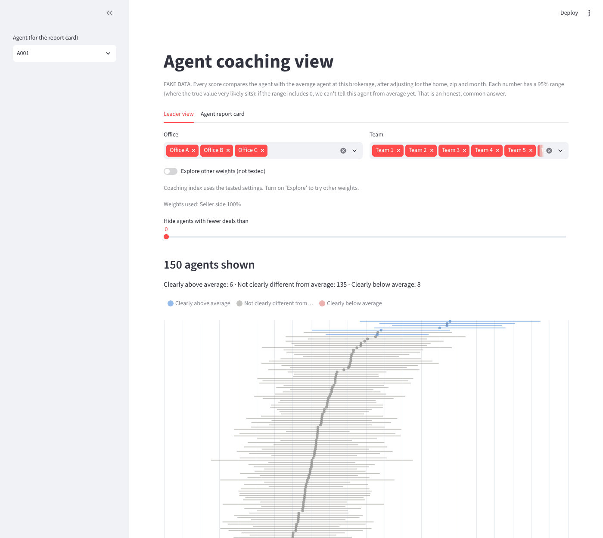
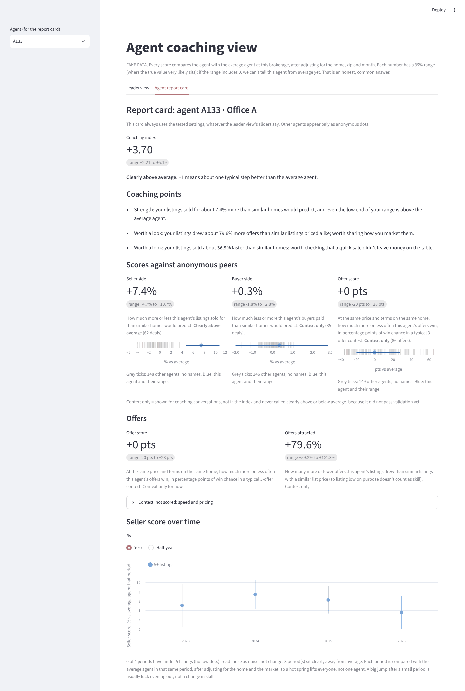
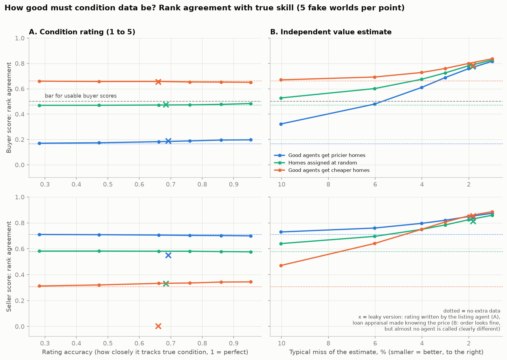
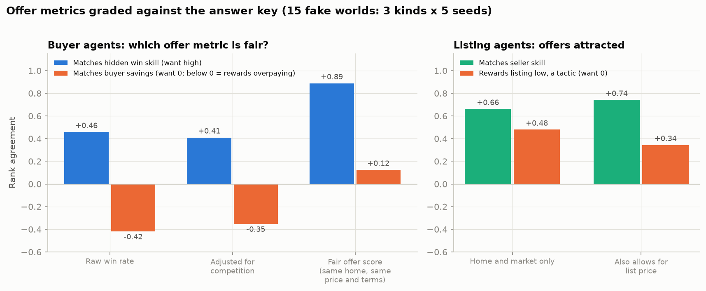
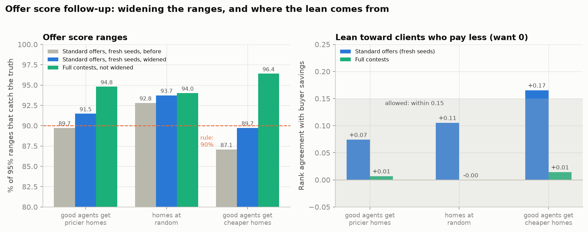

# agent-insights

[](https://github.com/jareddixon-ai/agent-insights/actions/workflows/tests.yml)

Coaching tool that shows real estate brokerages how well each agent does for clients: what homes sold for versus what they were worth, what buyers paid, and how often an agent's offers win. The public version runs on **fake data only** (Santa Barbara-style prices, California tax records). A brokerage runs a private copy on its own data. [Live demo on fake data](https://agent-insights-qctsf9jrkaqx4saj4vs72g.streamlit.app).

Results are framed as coaching, not rankings: every score is a percent versus the average agent, with an honest range. A range that includes 0 means "not clearly different from average yet".

## What it does

1. **Fake data** (`src/generate_fake_data.py`): 150 agents, 5,000 sales, about 12,500 offers, with hidden skills so we can grade the model. Since Phase 4.5 the tax records follow California's Prop 13 (assessed value = last sale price, raised at most 2% a year) and each sale has its prior sale date and price.
2. **Naive ranking** (`src/naive_ranking.py`): average sold price per agent. Shows why the obvious approach misleads (selection bias, small samples).
3. **Model** (`src/agent_model.py`): predicts price from the home, zip, month, trend and county records, then credits each agent for what is left over (seller side and buyer side separately).
4. **Shrinkage** (`src/shrinkage.py`): pulls thin records toward average and adds 95% ranges. How much agents really differ is measured the way meta-analysis combines studies (busy agents count more).
5. **Offer win rates** (`src/offer_win_rates.py`): wins / offers made, shrunk the same way. Kept to show the trap: it rewards clients who pay more (see 17).
6. **Messy data** (`src/make_messy_data.py`, `src/clean_data.py`): a dirty export and the cleaner that handles it.
7. **Coaching dashboard** (`app/coaching_app.py`): Streamlit app read from `rankings.csv` and `trends.csv`. Leader view (office and team filters, tested weights with sliders behind an Explore toggle, everyone with ranges, trends) and an agent report card (anonymous peers when there are 10 or more, 2 or 3 coaching points). See "How to read the dashboard" below.
8. **Stress test** (`src/stress_test.py`): rebuilds the fake data with selection bias flipped (better agents get cheaper homes).
9. **Price model** (`src/price_model.py`): home-only price, cross-validated (every home predicted by a model that never saw it).
10. **Speed and pricing** (`src/speed_and_pricing.py`): days on market vs similar homes, and list price vs model value. Context only, because the agent controls list price.
11. **Bootstrap ranges** (`src/bootstrap_ranges.py`): refits the model on 1,000 resampled histories (2 to 3 minutes) and flags agents with under 5 deals.
12. **Coaching table** (`src/score_agents.py`, `config/scoring.json`): the coaching index with a range, saved as `data/fake/rankings.csv`. Ranges include a bias allowance. Parts with weight 0 are shown as context only.
13. **Validation** (`src/validate.py`): grades every score against the hidden answer key, by number of deals, with shrinkage on and off, across 5 fake worlds, and with a check that needs no answer key.
14. **Prop 13 test** (`src/sale_history_test.py`): what California tax values cost the model, and how much the last sale date and price win back.
15. **Condition data test** (`src/condition_test.py`): how good must extra home data be before buyer scores are usable? Tests a 1-to-5 condition rating and an independent value estimate at several accuracy levels, plus two leaky versions.
16. **Offers that work like real ones** (in `src/generate_fake_data.py`): price, financing, down payment, contingencies, days to close, asking price on the day, number of competing offers. The highest price usually wins, but not always.
17. **Fair offer metrics** (`src/offer_metrics.py`): the fair offer score compares offers on the same home at the same price and terms; offers attracted compares listings with similar listings priced alike.
18. **Offer PDFs and extractor** (`src/make_offer_pdfs.py`, `src/extract_offers.py`): fake offer PDFs with made-up buyers, and an extractor that keeps the numbers and stores no names, emails, phones or notes.
19. **Offer validation** (`src/offer_validate.py`): grades the offer metrics against the answer key in 15 fake worlds and decides, by a rule set in advance, whether the offer score earns weight.
20. **Offer score follow-up** (`src/offer_calibrate.py`, `src/offer_lean_test.py`): widens the offer score's ranges on one set of fake worlds and confirms on fresh ones; then tests whether its lean comes from how the fake losing offers are made.
21. **Trends** (`src/trends.py`): each agent's seller score by year and by half-year, with ranges and small-sample flags.
22. **Coaching points** (`src/coaching_points.py`): turns one agent's row into 2 or 3 one-sentence points, with rules on when a strength or focus area may be named.
23. **Private copy** (`config/column_mapping.json`, `src/readiness_check.py`, `src/run_private.py`): a brokerage points its own column names at ours, gets a plain-English readiness report, and scores its own data with no code edits. `src/make_fake_export.py` makes a messy fake export to try it on. See "Private copy" below.

24. **Public demo** (`src/build_demo.py`, `demo/`): a saved snapshot of the fake scores so the hosted dashboard opens instantly. See "Public demo and pitch kit" below.

## Run it

```bash
python -m venv .venv && source .venv/bin/activate
pip install -r requirements.txt
python src/generate_fake_data.py        # writes data/fake/ (not committed; seed 42 repeats exactly)
cd src
python naive_ranking.py && python agent_model.py && python shrinkage.py && python offer_win_rates.py
python stress_test.py && python price_model.py && python speed_and_pricing.py
python bootstrap_ranges.py && python offer_metrics.py && python score_agents.py   # bootstrap 2-3 minutes
python trends.py                                        # seller score by year and half-year, a few seconds
python validate.py && python sale_history_test.py && python condition_test.py     # charts in docs/, about 1 minute
python make_offer_pdfs.py && python extract_offers.py   # 100 fake offer PDFs, about 30 seconds
python offer_validate.py                                # 15 fake worlds, about 7 minutes
python offer_calibrate.py && python offer_lean_test.py  # 45 fake worlds, about 25 minutes (cached after the first run)
python make_fake_export.py                              # messy fake "brokerage export" for private-copy mode
cd ..
python src/readiness_check.py --mapping config/column_mapping_demo.json   # what's there, what's missing
python src/run_private.py --mapping config/column_mapping_demo.json --resamples 200   # about 1 minute
streamlit run app/coaching_app.py
python src/build_demo.py                 # only when results change: rebuilds the demo/ snapshot, about 3 minutes
pytest                                   # automated tests, about 2 minutes
```

To open the dashboard on the private-copy demo instead of the main fake data, use the command `run_private.py` prints at the end (it sets `AGENT_INSIGHTS_DATA` to the scored folder).

## How to read the dashboard

Run `streamlit run app/coaching_app.py` after the pipeline. Everything below is fake data.



**Leader view** (for an office or brokerage leader)
- **Filters** pick offices and teams. They only choose who is shown: every score still compares the agent with the average agent at the whole brokerage.
- **Tested weights by default.** The coaching index (a blend of the parts, where +1 = about one typical step better than the average agent) uses the tested weights from `config/scoring.json`: seller only. Weight sliders appear only after a leader turns on **Explore other weights (not tested)**. Turning on the buyer or offer score then shows a warning with one sentence on why that part failed validation. Turning Explore off puts the tested weights back. We chose a toggle over logging slider moves because a safe default prevents the mistake, while a log only records it afterward.
- **Every number has a 95% range** (where the true value very likely sits). If the range includes 0, the agent is **"not clearly different from average"**. That is the most common answer (135 of 150 agents here), and it is honest, not a failure.
- **Seller score over time** shows each year or half-year, compared with the average agent in that same period. Hollow dots have under 5 listings: read them as noise. By half-year, the typical agent has 3 listings per period, so most swings are luck, not change.



**Agent report card** (for a coaching conversation with one agent)
- Always uses the tested settings, whatever the leader's sliders say.
- Other agents appear only as grey ticks with no names, and only when at least 10 other agents have that score. With fewer, the chart is hidden: 3 or 4 ticks on a small team can point to individuals. (`min_peers` in `config/scoring.json`; the app never goes below 10.)
- **Coaching points:** a "Strength" or "Focus area" is named only when the whole range is on one side of 0, and only for a part that passed validation. Context-only numbers (buyer score, offer score, speed, list price vs value, offers attracted) are worded "Worth a look", never as a verdict. If nothing is clear, it says so.
- **Offer score:** at the same price and terms on the same home, how much more or less often this agent's offers win, in percentage points of win chance in a typical 3-offer contest. **Offers attracted:** how many more or fewer offers this agent's listings drew than similar listings with a similar list price.

## What the fake data shows (graded against the hidden answer key)

| Test | Result |
|---|---|
| Naive ranking (average sold price) when better agents get pricier / random / cheaper homes | 0.83 / 0.20 / -0.71 rank agreement with true skill |
| Model, same three worlds | 0.71 / 0.58 / 0.31 |
| Seller score vs true skill (standard world) | rank agreement 0.74, 95% ranges catch the truth 97% of the time |
| Buyer score vs true skill | rank agreement 0.17 on average over 5 worlds. Shown as context only |
| Price model median error (cross-validated) | 4.6% (5.0% with no county records, 5.5% with the tax value but no sale date) |
| Agents called "clearly above" or "clearly below" average who truly are | 100% (14 of 150 agents); the other 135 are "not clearly different from average", 1 has no listings |
| Buyer score with a perfect 1-to-5 condition rating | 0.20 (no help). With an independent value estimate of 4% typical miss: 0.61 / 0.67 / 0.73 across the three worlds |
| Offer metrics, rank agreement with hidden win skill | raw win rate 0.46, fair offer score 0.89 |
| Offer extractor on 100 fake PDFs | 100 read back exactly; no names, emails or phones stored |

Rank agreement: 1 means the scores put agents in exactly the true order, 0 means no relation.

## California tax values (Phase 4.5)

Until Phase 4.5 our fake assessed values were the true value plus or minus about 4.5%. No California county produces that. Under Prop 13 a home's assessed value is set to what it sold for, then rises at most 2% a year until it sells again. Prices rose faster, so a home owned for 25 years carries a tax value far below its worth. In the new fake data the typical assessed value is 69% of true value, and 38% for homes owned 20+ years. Owners have held homes a median of about 10 years, in line with US sellers.


- **If the model ignores when each home last sold**, agents who mostly list long-held homes (estates, older owners) look 3.0 points better than they are, and the buyer score points the wrong way (-0.20).
- **Adding the last sale date and price** removes the estate-specialist bias (0.0 points) and brings the seller side back to 0.71.
- **The buyer side stays weak (0.17).** County records can't show a home's condition, and good agents tend to get the nicer homes. When the model is allowed to see true home value, buyer rank agreement is 0.87. A brokerage that wants buyer scores needs a better read on condition: pre-listing condition notes, inspection reports, or a rating from listing photos.

## Condition data (Phase 5-0): how good must it be?

Hidden home value has been the main problem on both sides. The obvious fix is a condition rating. We tested one at every accuracy from a rough guess to a perfect read, and an independent estimate of what each home was worth when it listed (like a pre-listing appraisal), in three kinds of world, 5 fake worlds each.



- **A condition rating barely helps.** Even a perfect one moves buyer rank agreement from 0.17 to 0.20. In California data the last sale price already carries most of a home's lasting quality. What is still hidden is what changed since that sale, luck in that sale, and the price model's shape (it misses at the cheap and expensive ends, and selection bias lines that miss up with skill).
- **An independent value estimate works.** With a typical miss of about 4% (about 3% median miss against the sale price), buyer scores clear the bar set before testing (rank agreement 0.5 or better and 90%+ of clear calls right, in every kind of world). It also fixes the seller score's lean on selection bias: 0.80 / 0.75 / 0.75 instead of 0.71 / 0.58 / 0.31.
- **Leaky data looks great and hides everyone.** A loan appraisal is made after the contract, with the price in hand. It misses the sale price by only about 1%, but it absorbs half of each agent's effect, so almost no agent is called clearly different (19 seller calls fall to under 1). A condition rating written by the listing agent does the same to the seller score (0.71 to 0.55; 0.31 to 0.00 when good agents get cheaper homes). The estimate must come from someone else, before the price is known.

Our fake data has no value estimate, so buyer scores stay context only.

## Offers (Phase 5)

Fake offers now work like real ones: each has a price, financing, down payment, contingencies and a closing time, and the strongest offer wins. The highest price wins about 85% of the time; otherwise the winner had better terms or a stronger agent.



- **Raw win rate rewards overpaying.** Agents whose clients pay more win more: rank agreement with buyer savings -0.42. Adjusting only for the number of competing offers doesn't fix it.
- **The fair offer score asks one question:** on the same home, at the same price and terms, how often does this agent's offer win? It compares offers within each home (a conditional logit, the standard model for 1 winner out of N), so hidden home quality cancels out. Rank agreement with hidden win skill 0.89 (raw: 0.46), no reward for overpaying, and 98% of its clear calls are right. It also recovers what sellers treat each term as worth: cash about 1% of price, each contingency about 0.4% to 0.6%.
- **It still does not get weight.** The rule set before testing asks for ranges that catch the truth 90% of the time and a lean toward agents whose clients pay less of at most 0.15. See the follow-up below.
- **Offers attracted** (listing agents): how many more (or fewer) offers this agent's listings draw than similar listings, in %. Listing low draws more offers, so the fair version compares listings priced alike (rank agreement with seller skill 0.74, vs 0.66 home-only). Context only.
- **Offer PDFs**: `make_offer_pdfs.py` writes fake offers in two layouts with made-up buyers. `extract_offers.py` reads them back exactly and refuses any row that would store a buyer's name, email or phone. Notes are dropped entirely, because removing names is not enough ("our kids start at Roosevelt in fall" still says who they are).

### Follow-up (Oct 28): wider ranges, and where the lean comes from



- **Widening, sized on one set of worlds, checked on fresh ones.** On seeds 42-46 the ranges missed mostly for agents with 80+ offers (83% caught), the sign of a small steady bias rather than noise. So the ranges get an allowance of 0.1% of price, added like an independent error (`offer_range` in `config/scoring.json`): narrow ranges grow most. That reached 90% in every kind of world. On fresh seeds 47-51, with the setting frozen: 91.5% / 93.7% / 89.7%.
- **The rule still fails, in one world.** Where good agents get cheaper homes, coverage is 89.7% (rule 90%) and the lean is 0.165 (rule 0.15). Widening can't fix a lean: it changes the range, not the score. Weights stay seller only.
- **The lean comes from the fake data.** Our fake losing offers are drawn after the sale, priced around the winner. When a thrifty agent's client wins at a low price, the rivals are placed relative to that low price, so the agent looks like it beat higher offers. In a side world with full contests (same bidders and terms, every price drawn the same way, strongest offer wins), the lean is 0.00 to 0.01 and ranges catch the truth 94% to 96% with no widening. The cost: win-skill agreement 0.84 to 0.87 and fewer clear calls, because full contests have more luck in who wins.
- **What we did not do:** grade the rule on the side world and turn the weight on. The rule was set for the standard worlds and it failed there. The honest next step is to make full contests the standard fake offers and run the same rule on new seeds.

## Validation

Every agent in the fake data has a hidden true skill, so we can check the model against it. A real brokerage can't, which is why this check happens here, before anyone trusts a score.


Each dot is an agent. Seller scores line up with the truth; buyer scores barely do. Shrinkage pulls thin records toward average on purpose, so the dots sit flatter than the dashed line.


Average sold price looks smart only when good agents happen to get pricier homes. Flip that and it ranks agents backwards (-0.71). The model holds up far better (0.71 / 0.58 / 0.31), but less well than with the Phase 4 fake data (0.72 to 0.76 in every world). With California records more of each home's quality is hidden, so the seller score also leans on selection bias: part of its 0.71 comes from good agents getting nicer homes.

**Shrinkage on vs off** ([chart](docs/accuracy_by_deals.png)): shrinkage cuts the average miss about in half (seller 1.82 to 0.95 points, buyer 2.24 to 0.87). For agents with 1 to 4 deals it cuts the miss from 3.8 to 1.1 points (seller) and 6.4 to 1.0 (buyer). For agents with 50+ deals it barely changes anything: it only leans on the average when the agent's own record is thin.

**Checking without an answer key.** A brokerage has no hidden truth, so `validate.py` also scores every agent twice, on the first and second half of their sales by date, and asks how well the two halves agree. For sellers in the standard world that check guesses the real accuracy almost exactly (0.65 guessed, 0.65 true). For buyers it is fooled completely: 0.52 guessed, 0.00 true, because hidden home quality repeats in both halves and looks like skill. Consistent is not the same as correct.

## Honest failure list

1. **Hidden home quality is the main problem, on both sides** ([chart](docs/hidden_quality.png)). The model can't see everything that makes a home valuable (view, condition, finishes). Each agent's score miss tracks that hidden value almost perfectly (correlation 0.96 seller, -0.98 buyer), and good agents get homes with more of it (correlation +0.3 to +0.4 with true skill). It flatters good sellers, which props up the seller ranking, and makes good buyer agents look like they overpaid. Fix: better condition data, not a fancier model.
2. **Buyer and offer scores are context only.** Both have weight 0 in `config/scoring.json`, so the coaching index is the seller score for now. Buyer: rank agreement 0.17; it needs an independent value estimate of each home (about 4% typical miss or better), which the data doesn't have. Offers: the fair offer score works well (0.89), but even with calibrated wider ranges it missed the pre-set rule on fresh fake worlds in one of three kinds of world (coverage 89.7%, lean 0.165). The side test says the fault is in the fake offers, not the score; it gets weight only after it passes on better fake offers.
3. **Hidden home value is not mainly "condition".** Phase 4 said better condition data would fix it. It doesn't: a perfect condition rating adds almost nothing. What's missing is what changed since the last sale and a price model with the right shape. Only an independent value estimate fixed it in testing.
4. **The bias allowance is an assumption.** Ranges get extra room for about 0.8 points of bias (one standard deviation). That brings agents with 50+ deals from 85% to 93% caught (seller) and 74% to 97% (buyer), at the cost of fewer clear calls. It was sized on fake data. If real bias is bigger, ranges are still too narrow, and the no-answer-key check can't tell.
5. **Agents with under 5 deals get no real feedback.** The bootstrap range catches the truth only 86% (seller) and 57% (buyer) of the time for them, so the table uses the wider of two ranges plus the allowance. None of the 14 agents with 1 to 4 listings is called clearly different from average. New agents get a "first look" flag, not a score.
6. **When more parts are turned back on, the index assumes their errors are independent.** Measured for seller and offer scores: they are not linked (correlation 0.00 to 0.04). Seller and buyer scores come from the same regression and the same homes, so theirs probably are. Not measured yet.
7. **Fake losing offers are drawn to fit the real winner.** That keeps every sale unchanged, but it is not how a real contest works. Tested Oct 28: it causes both the offer score's lean toward clients who pay less and its too-narrow ranges (full contests: lean 0.00 to 0.01, ranges 94% to 96%). Until the standard fake offers are rebuilt as full contests, the offer score's lean and range coverage look worse than they should, while its win-skill agreement looks a little better (0.89 vs 0.84 to 0.87). Real offer data is the real test.
8. **Weight sliders can still turn on untested parts.** Since Phase 7 they sit behind an "Explore" toggle and the tested weights are the default, but a leader who turns Explore on can rank people on a score that failed validation. The app warns; the report card ignores the sliders. Trends by half-year are mostly small samples (59% of agent-periods have under 5 listings).
9. **The fake world was built by the same people who built the model.** Skill never changes, no teams share credit, no dual agency. Passing these tests is necessary, not sufficient.
10. **Private copies have no answer key.** A brokerage can't grade its own scores against true skill. The split-half check in `validate.py` helps on the seller side and is fooled on the buyer side. The readiness check says what data is missing; it can't say the scores are right.

**Added in Phase 7:** tested weights as the default view (sliders behind Explore), a 10-peer minimum for anonymous peer charts, the ethics section, and private-copy mode with a readiness check.

**Phase 5 follow-up (Oct 28):** offer score ranges calibrated (allowance 0.1% of price) and confirmed on fresh worlds; the lean traced to the fake losing offers. Weights unchanged.

**Fixed in Phase 5:** offers depend on price and terms, raw win rate replaced by the fair offer score, the offer extractor, and the correction above about condition data.

**Fixed in Phase 4.5:** California tax values and sale history (estate-specialist bias 3.0 to 0.0 points). A sturdier measure of how much agents really differ: the old one said buyer agents don't differ at all in 2 of 5 fake worlds, which set every buyer score to 0 with almost no range. When homes are assigned at random, buyer ranges now catch the truth 96% of the time instead of 66%. Bias allowance. Buyer and offer weights set to 0.

A skeptical statistics review of the whole method, with what has been fixed since, is in [docs/statistics_review.md](docs/statistics_review.md).

## Traps this project handles

Selection bias, small samples, market timing, list-price games, hidden home quality, California tax values, target leakage (including "helpful" data that already contains the answer), and win rates that reward overpaying. See `docs/data_dictionary.md`.

## Public demo and pitch kit

**Public demo:** [agent-insights-qctsf9jrkaqx4saj4vs72g.streamlit.app](https://agent-insights-qctsf9jrkaqx4saj4vs72g.streamlit.app) (fake data only). The dashboard is hosted for free on Streamlit Community Cloud straight from this repo (main file `app/coaching_app.py`, Python 3.12). Generated data is never committed, so the hosted app reads `demo/`: two small fake files (`rankings.csv`, `trends.csv`) written by `python src/build_demo.py` with the same seed and 1,000 bootstrap resamples as "Run it". A faster rebuild with 200 resamples moves one agent across the line (7 "clearly above" instead of 6), so the demo uses the saved snapshot instead, and a test checks it still matches. The app reads `demo/` only when `data/fake/` has no scores and no private folder is set; a private copy never falls back to fake numbers.

**Tests on every push.** `.github/workflows/tests.yml` runs the full test suite on GitHub after every push (the badge at the top). It needs no secrets: the tests build their own fake data.

**Pitch kit numbers.** The pitch kit quotes only results on fake data. `docs/pitch_numbers.md` lists each number, what it means and the README text it comes from; a test fails if any of them stops matching. One more figure the kit uses, from the readiness check on the fake data: with a median of 19 listings per agent, expect most agents to be "not clearly different from average" (fake data: 135 of 150 at a median of 19).

## Ethics

agent-insights scores people, with noisy numbers, for a business that pays them. That needs rules, not just good intentions.

**What it is for.** Coaching conversations: an agent and a leader looking at the same card, asking "what is working, and what is worth a look?" Every number is meant to start a conversation, not end one.

**What it is not for.** It is not for firing, pay, bonuses, or ranking people on one number. The coaching index is a blend with a range, and most agents (135 of 150 in the fake data) are "not clearly different from average". Ranking those 135 against each other is ranking luck. A leader who wants to act on a score should look at the range first: if it includes 0, there is nothing to act on.

**The honest limits, in plain words.**
- **Ranges measure luck, not bias.** A 95% range says how much the score could move by chance. It can't see a steady bias, like good agents getting nicer homes than the data shows. We add a bias allowance, but its size is an assumption.
- **Buyer and offer scores failed testing.** The buyer score needs an independent value estimate of each home that the data doesn't have. The offer score missed its pre-set rule narrowly. Both are shown as "context only" and never called clearly above or below.
- **The weight sliders can turn on untested parts.** They sit behind an "Explore" toggle and come with a warning, but they still work. The agent's own card always uses the tested settings.
- **Small samples and half-year trends are mostly noise.** An agent with under 5 deals gets a first look, not a score. By half-year, the typical agent has 3 listings per period; a dip after a great half is usually luck evening out (regression to the mean), not a slump.
- **Without the last sale date and price, California data misleads.** Agents who list long-held homes look better than they are. The readiness check says so when it's missing.

**Privacy.**
- The public repo holds fake data only. Never put real client, MLS or brokerage data in it.
- A private copy reads only the columns named in its mapping, and stores only what the metrics use (listed in `docs/data_dictionary.md`, "Private copy"). It never reads or stores addresses, client names, emails, phones, notes or any column you didn't map. Offer PDFs go through `src/extract_offers.py`, which keeps the numbers and drops names and free text.
- The readiness check refuses to run if the data folder is inside the repo and not git-ignored, and it prints counts only, never a value from your files.
- Agent IDs must be codes, not names (the check blocks IDs that look like names or emails). Leaders see IDs; peers on a card are anonymous ticks, shown only with 10 or more peers.
- **Agents should see their own card before a manager uses it**, and be able to say what the data missed (a hard estate sale, a family friend's listing). A score the agent has never seen should not be in a performance conversation.

## Private copy

How a brokerage runs agent-insights on its own data, without editing code.

1. **Put your export in `data/private/`** (git-ignored). Any folder outside the repo also works. Sales are required; an agent roster and offers are optional.
2. **Map your columns** in `config/column_mapping.json`: our name on the left, your exact header on the right, `null` for anything you don't have. Columns you don't list are never read. `config/column_mapping_demo.json` shows a filled-in example for the fake export.
3. **Run the readiness check:** `python src/readiness_check.py`. It reads your files and says in plain sentences what is there, what is missing, and what that turns off. For example: no independent value estimate means buyer scores stay context only; no offer data means no offer score; a median of under 5 listings per agent means almost everyone will be "not clearly different from average". It also catches leaky data, like a value estimate that sits suspiciously close to the sale price (a loan appraisal made with the price in hand).
4. **Score:** `python src/run_private.py`. It stores the cleaned columns it uses in `data/private/standard/`, writes scores to `data/private/scored/`, and prints the command to open the dashboard on them.
5. **Show each agent their card first.** Then use it in coaching.

On the messy fake export (renamed columns, prices typed as text, duplicates, unsold rows, no sale history, no offers, plus fake names, emails, phones, addresses and notes that are never read): 4,800 of 5,050 rows usable, no personal detail printed or stored, and seller rank agreement with true skill 0.62. The clean fake data with that one column removed gives 0.60, and with it 0.74: the missing column costs far more than all the mess.

Weights and the `validation` block in `config/scoring.json` stay as tested on fake data. A private copy should change them only after running its own validation, never to silence a warning.
