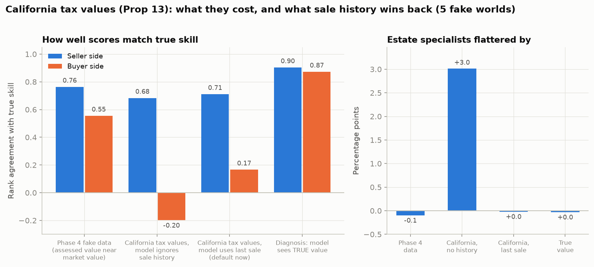
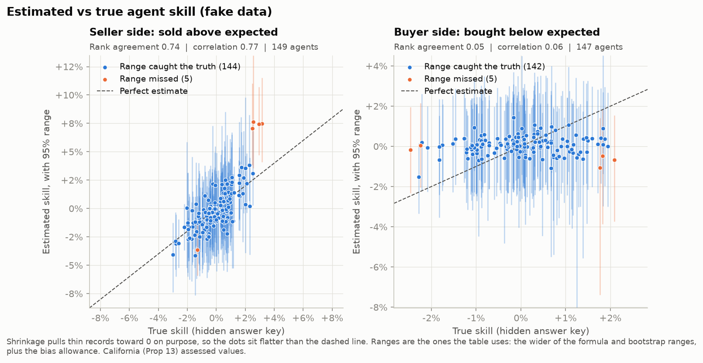
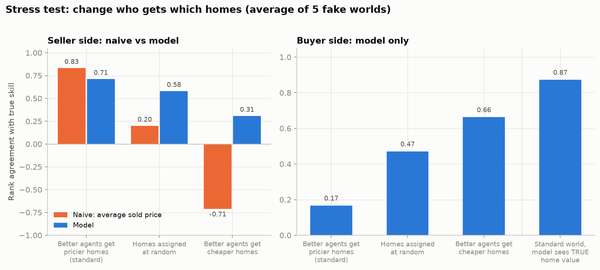

# agent-insights

Coaching tool that shows real estate brokerages how well each agent does for clients: what homes sold for versus what they were worth, what buyers paid, and how often an agent's offers win. The public version runs on **fake data only** (Santa Barbara-style prices, California tax records). A brokerage runs a private copy on its own data.

Results are framed as coaching, not rankings: every score is a percent versus the average agent, with an honest range. A range that includes 0 means "not clearly different from average yet".

## What it does

1. **Fake data** (`src/generate_fake_data.py`): 150 agents, 5,000 sales, 12,600 offers, with hidden skills so we can grade the model. Since Phase 4.5 the tax records follow California's Prop 13 (assessed value = last sale price, raised at most 2% a year) and each sale has its prior sale date and price.
2. **Naive ranking** (`src/naive_ranking.py`): average sold price per agent. Shows why the obvious approach misleads (selection bias, small samples).
3. **Model** (`src/agent_model.py`): predicts price from the home, zip, month, trend and county records, then credits each agent for what is left over (seller side and buyer side separately).
4. **Shrinkage** (`src/shrinkage.py`): pulls thin records toward average and adds 95% ranges. How much agents really differ is measured the way meta-analysis combines studies (busy agents count more).
5. **Offer win rates** (`src/offer_win_rates.py`): wins / offers made, shrunk the same way.
6. **Messy data** (`src/make_messy_data.py`, `src/clean_data.py`): a dirty export and the cleaner that handles it.
7. **Coaching app** (`app/coaching_app.py`): Streamlit view per agent, read from `rankings.csv`: coaching index, scores with ranges, context.
8. **Stress test** (`src/stress_test.py`): rebuilds the fake data with selection bias flipped (better agents get cheaper homes).
9. **Price model** (`src/price_model.py`): home-only price, cross-validated (every home predicted by a model that never saw it).
10. **Speed and pricing** (`src/speed_and_pricing.py`): days on market vs similar homes, and list price vs model value. Context only, because the agent controls list price.
11. **Bootstrap ranges** (`src/bootstrap_ranges.py`): refits the model on 1,000 resampled histories (2 to 3 minutes) and flags agents with under 5 deals.
12. **Coaching table** (`src/score_agents.py`, `config/scoring.json`): the coaching index with a range, saved as `data/fake/rankings.csv`. Ranges include a bias allowance. Parts with weight 0 are shown as context only.
13. **Validation** (`src/validate.py`): grades every score against the hidden answer key, by number of deals, with shrinkage on and off, across 5 fake worlds, and with a check that needs no answer key.
14. **Prop 13 test** (`src/sale_history_test.py`): what California tax values cost the model, and how much the last sale date and price win back.

## Run it

```bash
python -m venv .venv && source .venv/bin/activate
pip install -r requirements.txt
python src/generate_fake_data.py        # writes data/fake/ (not committed; seed 42 repeats exactly)
cd src
python naive_ranking.py && python agent_model.py && python shrinkage.py && python offer_win_rates.py
python stress_test.py && python price_model.py && python speed_and_pricing.py
python bootstrap_ranges.py && python score_agents.py   # bootstrap takes 2-3 minutes
python validate.py && python sale_history_test.py      # charts in docs/, about 25 seconds
cd ..
streamlit run app/coaching_app.py
pytest                                   # automated tests
```

## What the fake data shows (graded against the hidden answer key)

| Test | Result |
|---|---|
| Naive ranking (average sold price) when better agents get pricier / random / cheaper homes | 0.83 / 0.20 / -0.71 rank agreement with true skill |
| Model, same three worlds | 0.71 / 0.58 / 0.31 |
| Seller score vs true skill (standard world) | rank agreement 0.74, 95% ranges catch the truth 97% of the time |
| Buyer score vs true skill | rank agreement 0.17 on average over 5 worlds. Shown as context only |
| Price model median error (cross-validated) | 4.6% (5.0% with no county records, 5.5% with the tax value but no sale date) |
| Agents called "clearly above" or "clearly below" average who truly are | 100% (14 of 150 agents); the other 135 are "not clearly different from average", 1 has no listings |

Rank agreement: 1 means the scores put agents in exactly the true order, 0 means no relation.

## California tax values (Phase 4.5)

Until Phase 4.5 our fake assessed values were the true value plus or minus about 4.5%. No California county produces that. Under Prop 13 a home's assessed value is set to what it sold for, then rises at most 2% a year until it sells again. Prices rose faster, so a home owned for 25 years carries a tax value far below its worth. In the new fake data the typical assessed value is 69% of true value, and 38% for homes owned 20+ years. Owners have held homes a median of about 10 years, in line with US sellers.



- **If the model ignores when each home last sold**, agents who mostly list long-held homes (estates, older owners) look 3.0 points better than they are, and the buyer score points the wrong way (-0.20).
- **Adding the last sale date and price** removes the estate-specialist bias (0.0 points) and brings the seller side back to 0.71.
- **The buyer side stays weak (0.17).** County records can't show a home's condition, and good agents tend to get the nicer homes. When the model is allowed to see true home value, buyer rank agreement is 0.87. A brokerage that wants buyer scores needs a better read on condition: pre-listing condition notes, inspection reports, or a rating from listing photos.

## Validation

Every agent in the fake data has a hidden true skill, so we can check the model against it. A real brokerage can't, which is why this check happens here, before anyone trusts a score.



Each dot is an agent. Seller scores line up with the truth; buyer scores barely do. Shrinkage pulls thin records toward average on purpose, so the dots sit flatter than the dashed line.



Average sold price looks smart only when good agents happen to get pricier homes. Flip that and it ranks agents backwards (-0.71). The model holds up far better (0.71 / 0.58 / 0.31), but less well than with the Phase 4 fake data (0.72 to 0.76 in every world). With California records more of each home's quality is hidden, so the seller score also leans on selection bias: part of its 0.71 comes from good agents getting nicer homes.

**Shrinkage on vs off** ([chart](docs/accuracy_by_deals.png)): shrinkage cuts the average miss about in half (seller 1.82 to 0.95 points, buyer 2.24 to 0.87). For agents with 1 to 4 deals it cuts the miss from 3.8 to 1.1 points (seller) and 6.4 to 1.0 (buyer). For agents with 50+ deals it barely changes anything: it only leans on the average when the agent's own record is thin.

**Checking without an answer key.** A brokerage has no hidden truth, so `validate.py` also scores every agent twice, on the first and second half of their sales by date, and asks how well the two halves agree. For sellers in the standard world that check guesses the real accuracy almost exactly (0.65 guessed, 0.65 true). For buyers it is fooled completely: 0.52 guessed, 0.00 true, because hidden home quality repeats in both halves and looks like skill. Consistent is not the same as correct.

## Honest failure list

1. **Hidden home quality is the main problem, on both sides** ([chart](docs/hidden_quality.png)). The model can't see everything that makes a home valuable (view, condition, finishes). Each agent's score miss tracks that hidden value almost perfectly (correlation 0.96 seller, -0.98 buyer), and good agents get homes with more of it (correlation +0.3 to +0.4 with true skill). It flatters good sellers, which props up the seller ranking, and makes good buyer agents look like they overpaid. Fix: better condition data, not a fancier model.
2. **Buyer scores and offer win rates are context only.** Both have weight 0 in `config/scoring.json`, so the coaching index is the seller score for now. Buyer: rank agreement 0.17, and its few "clearly above/below" calls were right only about half the time. Offers: in real deals the highest bid usually wins, so a high win rate can mean clients who bid more; our fake offers don't model that yet (Phase 5). On fake data, dropping both costs nothing in ranking power (0.59 either way, against the full blend of true skills).
3. **The bias allowance is an assumption.** Ranges get extra room for about 0.8 points of bias (one standard deviation). That brings agents with 50+ deals from 85% to 93% caught (seller) and 74% to 97% (buyer), at the cost of fewer clear calls. It was sized on fake data. If real bias is bigger, ranges are still too narrow, and the no-answer-key check can't tell.
4. **Agents with under 5 deals get no real feedback.** The bootstrap range catches the truth only 86% (seller) and 57% (buyer) of the time for them, so the table uses the wider of two ranges plus the allowance. None of the 14 agents with 1 to 4 listings is called clearly different from average. New agents get a "first look" flag, not a score.
5. **When more parts are turned back on, the index will assume their errors are independent.** Seller and buyer scores come from the same regression and the same homes, so their errors are probably linked. Not measured yet.
6. **The fake world was built by the same people who built the model.** Skill never changes, no teams share credit, no dual agency, offers are won without paying more. Passing these tests is necessary, not sufficient.

**Fixed in Phase 4.5:** California tax values and sale history (estate-specialist bias 3.0 to 0.0 points). A sturdier measure of how much agents really differ: the old one said buyer agents don't differ at all in 2 of 5 fake worlds, which set every buyer score to 0 with almost no range. When homes are assigned at random, buyer ranges now catch the truth 96% of the time instead of 66%. Bias allowance. Buyer and offer weights set to 0.

A skeptical statistics review of the whole method, with what has been fixed since, is in [docs/statistics_review.md](docs/statistics_review.md).

## Traps this project handles

Selection bias, small samples, market timing, list-price games, hidden home quality, California tax values, and target leakage. See `docs/data_dictionary.md`.

## Privacy

Never put real client, MLS or brokerage data in this repo. Private runs belong in `data/private/` (git-ignored).
